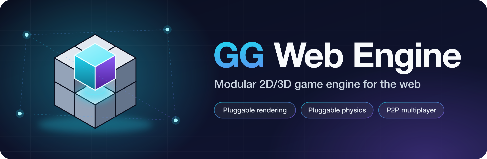

# GG Web Engine



**Multiplayer physics games in the browser, with no game server. Cars and character controllers
built in. TypeScript end to end.**

GG Web Engine is an open-source TypeScript game engine for the browser. A small, strictly typed core
(worlds, entities, clocks, input, levels, networking) drives battle-tested libraries plugged in
behind it: [Three.js](https://threejs.org/) or [Pixi.js](https://pixijs.com/) for rendering,
[Rapier](https://rapier.rs/), [Ammo.js](https://github.com/kripken/ammo.js) or
[Matter.js](https://brm.io/matter-js/) for physics.

[Live demos](https://gg-web-demos.guraklgames.com/) ·
[GitHub](https://github.com/AndyGura/gg-web-engine) ·
[npm](https://www.npmjs.com/package/@gg-web-engine/core) ·
[Changelog](https://github.com/AndyGura/gg-web-engine/blob/main/CHANGELOG.md)

## What it is best at

- **Shared physics worlds over WebRTC, peer to peer.** 2-8 players in one physics world, in 2D or
  3D. Ownership, late join, reconnection and replica correction are built in; the only backend is a
  signaling channel (Firebase on its free plan, or none between tabs of one browser).
- **Driving games.** A car model with engine, torque table and gearbox, plus raycast vehicles.
- **Character games.** First- and third-person controllers in 3D and a platformer controller in 2D,
  on every physics backend.
- **Levels as data.** JSON levels with your own entity classes, blueprint-wired events and a
  serialization round trip. 3D scenes can be authored in Blender with the bundled exporter add-on.

Switching to another physics backend of the same dimension takes one line and, apart from a few
gaps listed in the [FAQ](https://github.com/AndyGura/gg-web-engine#-faq), needs no gameplay-code
changes. Each backend keeps its own simulation behavior, so expect to retune physics after a switch.

## Install

Pick the core, one renderer and one physics engine of the same dimension. Each adapter brings the
exact library version it is built against.

| Combination | Install |
|---|---|
| 3D: Three.js + Rapier | `npm install @gg-web-engine/core @gg-web-engine/three @gg-web-engine/rapier3d` |
| 3D: Three.js + Ammo.js | `npm install @gg-web-engine/core @gg-web-engine/three @gg-web-engine/ammo` |
| 2D: Pixi.js + Rapier | `npm install @gg-web-engine/core @gg-web-engine/pixi @gg-web-engine/rapier2d` |
| 2D: Pixi.js + Matter.js | `npm install @gg-web-engine/core @gg-web-engine/pixi @gg-web-engine/matter` |

Optional: `@gg-web-engine/multiplayer` (peer-to-peer shared worlds), `@gg-web-engine/audio`
(positional audio), `@gg-web-engine/mobile-controls` (on-screen touch controls).

## Start from a template

Three Vite + TypeScript starter projects live under
[`templates/`](https://github.com/AndyGura/gg-web-engine/tree/main/templates). Copy one and run it:

```bash
npx degit AndyGura/gg-web-engine/templates/3d-character my-game
cd my-game && npm install && npm run dev
```

| Template | What you get |
|---|---|
| `3d-character` | Third-person character in a small arena, Three.js + Rapier |
| `2d-platformer` | Side-view platformer with coins and a parallax background, Pixi.js + Rapier |
| `multiplayer-cars` | Peer-to-peer driving arena: share the room link and drive together, Three.js + Rapier |

Each template has an `AGENTS.md` that points a coding agent at the engine guide.

## A first scene

```typescript
import { Gg3dWorld, LoadingScreen, Pnt3, Qtrn, TypedGg3dWorld } from '@gg-web-engine/core';
import { ThreeGgWorld, ThreeSceneComponent } from '@gg-web-engine/three';
import { Rapier3dGgWorld, Rapier3dWorldComponent } from '@gg-web-engine/rapier3d';

const loading = LoadingScreen.show(); // the engine's loading screen, until hide() below
const world: TypedGg3dWorld<ThreeGgWorld, Rapier3dGgWorld> = new Gg3dWorld({
  visualScene: new ThreeSceneComponent(),
  physicsWorld: new Rapier3dWorldComponent(),
});
await world.init();

const renderer = world.addRenderer(
  world.visualScene.factory.createPerspectiveCamera(),
  document.getElementById('gg') as HTMLCanvasElement,
);
renderer.position = { x: 12, y: 12, z: 12 };
renderer.rotation = Qtrn.lookAt(renderer.camera.position, Pnt3.O);

world.addPrimitiveRigidBody({
  shape: { shape: 'BOX', dimensions: { x: 7, y: 7, z: 1 } },
  body: { bodyType: 'static' },
});
const cube = world.addPrimitiveRigidBody({
  shape: { shape: 'BOX', dimensions: { x: 1, y: 1, z: 1 } },
  body: { mass: 1 },
});
cube.position = { x: 0, y: 0, z: 10 };

world.start();
loading.hide();
```

3D worlds are Z-up: `{x, y}` is the ground plane and `+Z` points to the sky.

## Building with an AI coding agent

The repository ships Claude Code skills that teach an agent the engine's mental model, API and
pitfalls:

```bash
npx skills add AndyGura/gg-web-engine --skill gg-engine-app-development -y
```

Other agents get the same guide without a step: it ships as
`node_modules/@gg-web-engine/core/AGENTS.md`. Before installing anything, an agent can read the
whole engine in one request from [llms-full.txt](llms-full.txt) (pitch, install lines, the guide
and one complete game per dimension), or start from the [llms.txt](llms.txt) index.

## Status

Releases so far are `0.0.N`, and the API can change between any two of them. Starting with 0.1.0,
breaking changes come only in a minor release (`0.1.x` to `0.2.0`), each listed in the CHANGELOG
with a migration note; the README's "Project status" has the full versioning policy. The
[README](https://github.com/AndyGura/gg-web-engine#readme) has an honest "when to use it, and when
not to" comparison with Three.js, Babylon.js, Phaser and Godot.

## API reference

The [modules](modules/index.md) section documents every package: `core` and each adapter
(`three`, `pixi`, `ammo`, `rapier2d`, `rapier3d`, `matter`).
