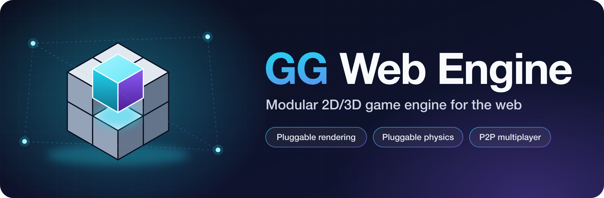

<p align="center">
  
</p>

## [Three.js](https://github.com/mrdoob/three.js) integration for [gg-web-engine](https://github.com/AndyGura/gg-web-engine), providing 3D rendering

### Installation:
1) make sure **@gg-web-engine/core** installed
1) `npm install --save @gg-web-engine/three`

The package brings `three` (with `@types/three`) as its own dependency, pinned to the exact version it is
built and tested against, so nothing else needs installing. If your app also imports it directly,
use that same version, so the bundle carries only one copy.

Addons are not included in three.js build, but `@gg-web-engine/three` provides GLTFLoader:
```
import { GLTFLoader } from '@gg-web-engine/three';
```

`.glb` files compressed with meshopt (`EXT_meshopt_compression`/`KHR_meshopt_compression`, as
`gltfpack -c`/`-cc` writes them) load as they are through `world.loader`. A `GLTFLoader` of your own
needs the decoder set, as three.js requires; `lazyMeshoptDecoder` is three's `MeshoptDecoder`,
fetched and compiled only when the first compressed file is decoded, in web workers:
```
import { GLTFLoader, lazyMeshoptDecoder } from '@gg-web-engine/three';

const loader = new GLTFLoader().setMeshoptDecoder(lazyMeshoptDecoder);
```
